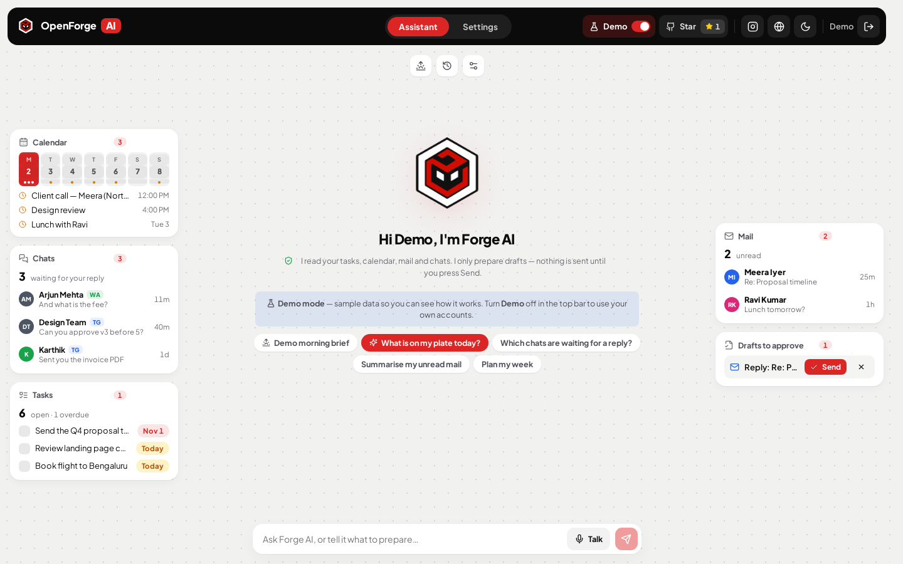
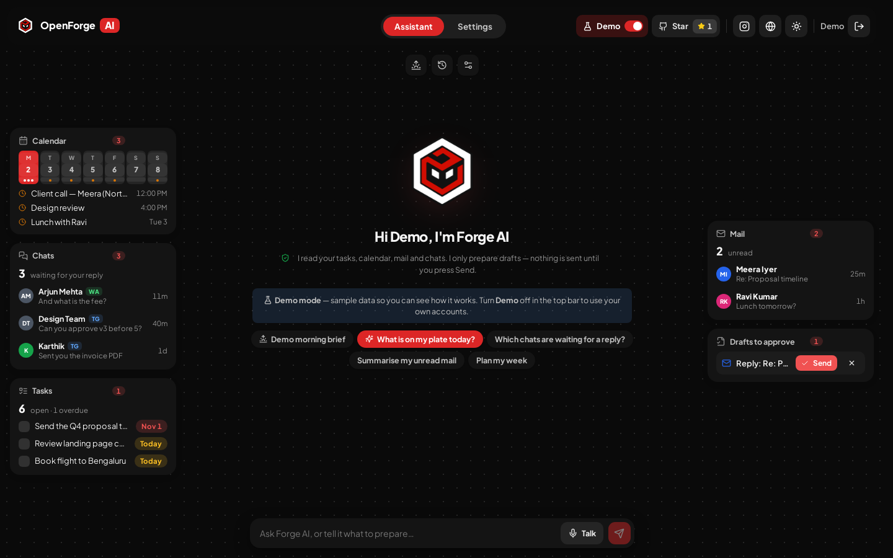
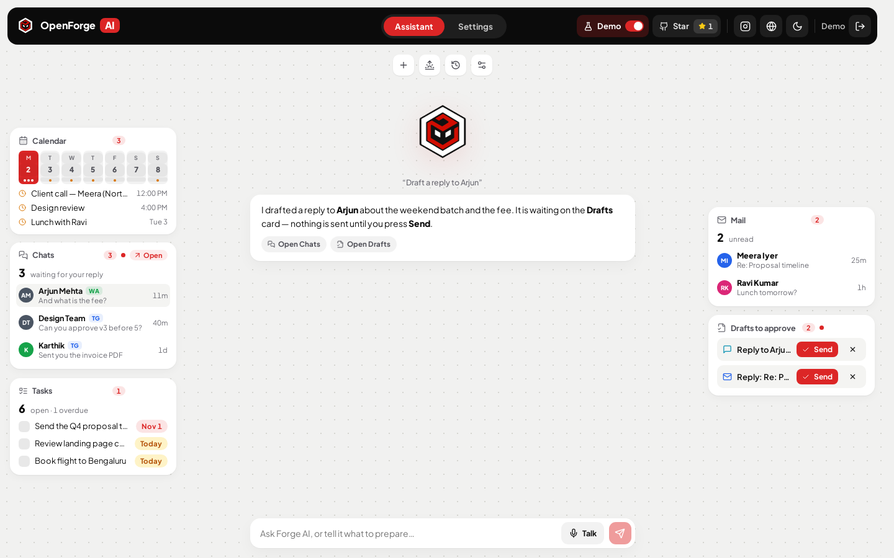
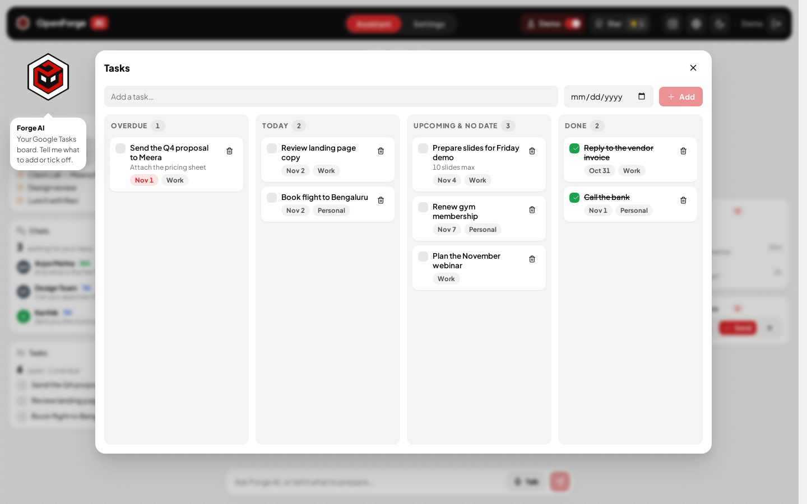
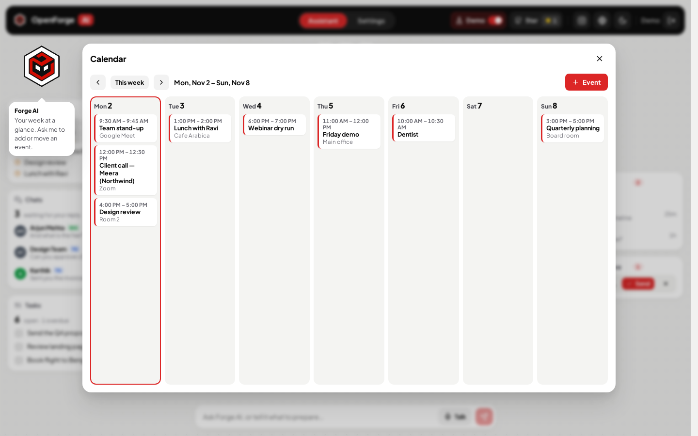
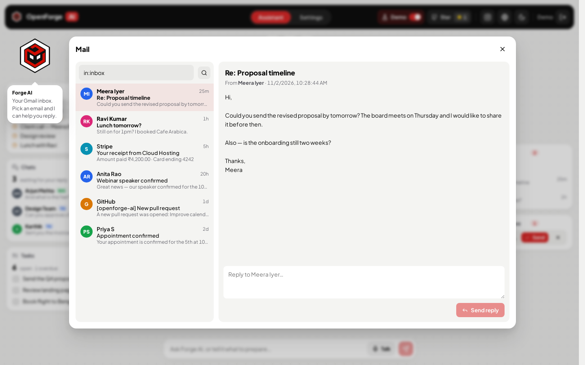
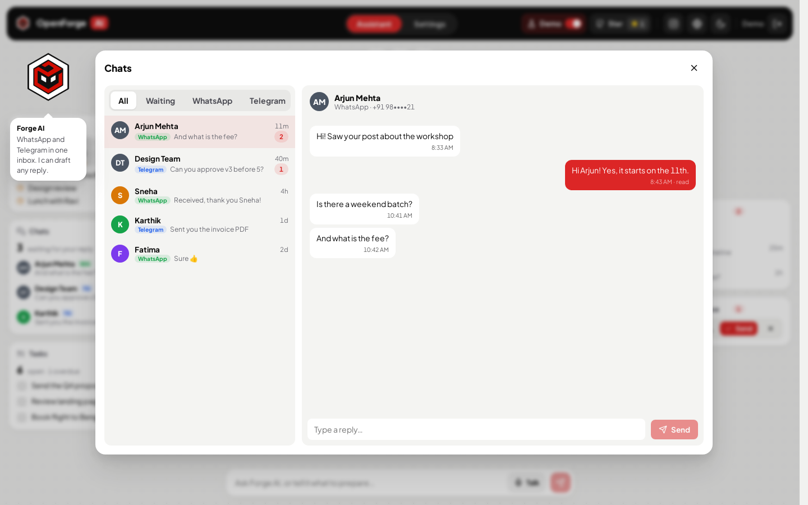
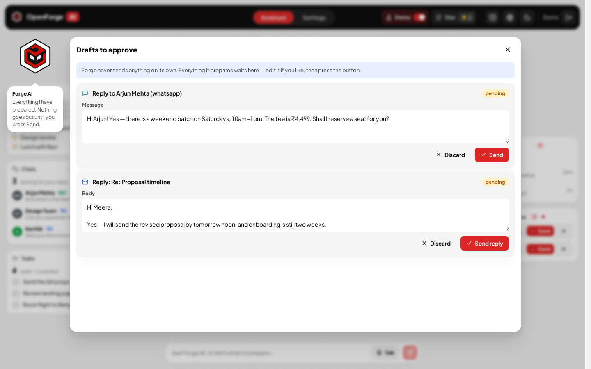
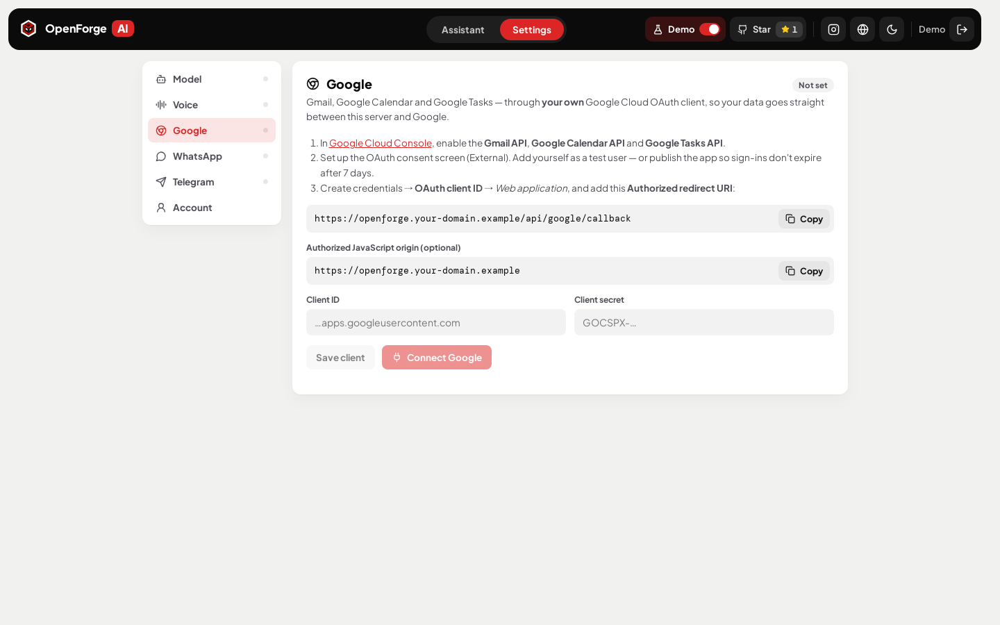
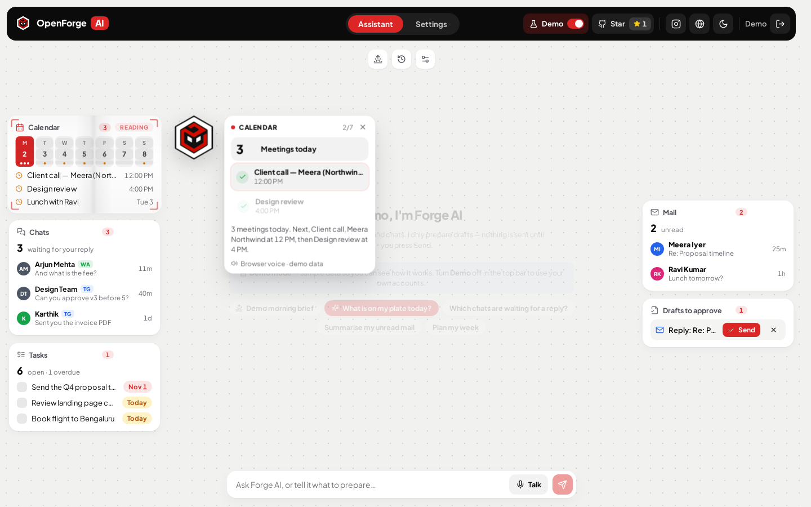

# Lord Minds

<p align="center"></p>

A self-hosted assistant for your **tasks, calendar, mail, chats, contacts, and automations** — in one Lord Minds workspace.



Lord Minds combines assistant tools, private CRM contacts, invited accounts, user-level permissions, Google Drive read access, Meta (WhatsApp, Instagram, and Messenger) plus Telegram messaging, direct Instagram/Facebook Page/YouTube uploads, comment automation, opt-in WhatsApp broadcasts, and local n8n workflow automation. Connect n8n under Settings → Automations. **→ [docs/EXTEND.md](docs/EXTEND.md)** shows how to extend the app.

Lord Minds puts your Google Tasks, Google Calendar, Gmail and a unified WhatsApp + Telegram inbox around an assistant called **Lord Minds AI**. Ask it anything ("what's on my plate today?", "which chats are waiting on me?", "draft a reply to Arjun") by typing, or press **Talk** and speak to it in real time.

**The AI assistant never sends or changes data on its own.** It prepares drafts for approval. Separate messaging automations only send after an account owner configures a flow and explicitly turns it live; WhatsApp broadcasts additionally require selecting contacts marked as opted in and confirming the send.

It ships with **zero credentials**. Every person on an install brings their own keys:

| What | Used for | Where you get it |
|---|---|---|
| OpenAI or Anthropic API key, or Ollama with a local model | the chat model + tool calling | platform.openai.com · console.anthropic.com · ollama.com |
| Gemini API key | **Talk** — real-time voice (Gemini Live) | aistudio.google.com/apikey |
| Google OAuth Client ID + Secret | Gmail, Calendar, Tasks, Drive, YouTube uploads and comment replies | Google Cloud Console; enable YouTube Data API v3 |
| WhatsApp Cloud API phone number ID + token | WhatsApp chats | developers.facebook.com |
| Facebook Page ID + access token + Meta app secret | Messenger messages and shared Meta flows | Meta for Developers; Page messaging and webhook permissions |
| Telegram bot token | Telegram chats | @BotFather |
| n8n API key | Browse and open local workflows in Automations | Local n8n at `http://localhost:5678` → Settings → n8n API |
| Meta Instagram account ID, access token, app secret | Instagram comment webhooks and private replies | Meta for Developers; requires a professional account and approved permissions |

Keys are entered on the **Settings** page and stored **encrypted** (AES-256-GCM) in the server's database. They are never sent back to the browser.

## Demo mode

Switch **Demo** on in the top bar to see every card filled with sample tasks, events, emails and chats, and to try the assistant with scripted answers — before you connect anything. A new user starts in demo mode until they connect something; the switch is remembered per browser. Demo data lives only in the browser tab and never touches your accounts.

## Screenshots

| | |
|---|---|
|  |  |
| **Dark theme** | **Lord Minds prepares a draft — you press Send** |
|  |  |
| **Tasks** — kanban over Google Tasks | **Calendar** — week view |
|  |  |
| **Mail** — Gmail inbox, reader and reply | **Chats** — WhatsApp + Telegram in one inbox |
|  |  |
| **Drafts to approve** | **Settings** — your own keys, step by step |
|  | |
| **Morning brief** — Lord Minds AI reads each card out | |

---

## Features

- **Office view** — slim rails of cards (Calendar, Chats, Tasks · Mail, Drafts) that open full size on click, the animated assistant in the middle with its latest answer, and a floating composer at the bottom. Light and dark themes.
- **Conversations** — every typed and spoken conversation is saved; reopen and continue any of them from the history button.
- **Demo mode** — sample data in every card so you can see it working before connecting anything.
- **Chat with tools** — Lord Minds reads your real data through tools (overview of the day, tasks, events, mail search/read, chats) and opens the relevant card on screen.
- **Talk** — live, interruptible voice with Gemini Live, using the same tools. Transcripts are saved to your conversation history.
- **Morning brief** — press the sunrise button (or the *Morning brief* chip) and Lord Minds AI flies from card to card — Calendar, Tasks, Mail, Chats, Drafts — reading out what each one shows, with the key numbers lighting up beside it as they are said, then ends with a plan for the day. Two modes:
  - **Demo morning brief** (Demo on): the demo data, read by your browser's built-in voice. Free, no keys, nothing leaves the page.
  - **Morning brief** (Demo off): your own data, read in the **Gemini Live** voice (your Gemini key, Settings → Voice). Without a Gemini key it uses the browser voice.

  The script is built from what the cards show (no model call, about a minute). It only reads — it never sends or changes anything.
- **Tasks** — a kanban (Overdue / Today / Upcoming / Done) over all your Google Tasks lists. Drag to re-date, tick to complete, add new.
- **Calendar** — a week view of your primary Google Calendar; add events.
- **Mail** — Gmail inbox with search, a reader and reply.
- **Chats** — one inbox for WhatsApp (Cloud API webhook) and Telegram (bot webhook). Reply from the app. Respects WhatsApp's 24-hour reply window.
- **CRM** — private contacts with a sales stage, tags, source, notes and explicit WhatsApp opt-in; a stage board, period totals and a monthly follow-up calendar use the same signed-in user's data. The assistant can search contacts in that account.
- **Flows** — separate **Upload** and **Flow Automation** sections. Upload posts media directly to YouTube, Instagram, or a Facebook Page. Comment flows can target a selected Instagram post or YouTube video; WhatsApp, Telegram, and Meta flows match incoming messages. YouTube flows scan the latest five videos unless a specific video is selected. Facebook Page post-comment automation is not supported yet.
- **Broadcasts** — queue Meta-approved WhatsApp templates for up to 25 selected contacts per campaign; server checks opt-in and records each delivery result.
- **Instagram** — configure a Meta webhook and manage keyword-triggered private replies to matching comments.
- **Automations** — Docker Compose runs a persistent local n8n instance at `http://localhost:5678`. Connect it in Settings → Automations with an n8n API key, then browse, open, activate and run workflows in n8n. Local schedules and outgoing integrations execute on this computer; external webhook triggers need a reachable HTTPS URL.
- **Drafts to approve** — everything the assistant prepares waits here for your button press.
- **Multi-user admin** — the first visitor creates the admin account; only invited people can register. Admins choose each invite's permissions and can temporarily open any user's workspace for up to eight hours. User data and credentials stay separate outside that explicit admin view.
- Phone numbers are masked in the assistant's view and answers.

For the repo-by-repo inventory and single-product consolidation map, see [docs/FORGEMIND_CONSOLIDATION.md](docs/FORGEMIND_CONSOLIDATION.md).

## Quick start

You need **Docker** with Compose v2 (Docker Desktop on Mac/Windows, or Docker Engine on Linux). Everything runs in one container — no database server, no Node install.

```bash
# From the Lord Minds project directory
./deploy.sh
```

`deploy.sh` checks Docker, creates `.env` from `.env.example` on the first run, builds the image, starts the container and waits until it is healthy. Other commands: `./deploy.sh update` (pull the latest code and rebuild — your data is kept), `./deploy.sh logs`, `./deploy.sh stop`. On the first run you can set the address and port inline:

```bash
PUBLIC_URL=https://assistant.example.com LORDMINDS_PORT=8080 ./deploy.sh
```

<details><summary>Without the script (plain Docker Compose, also for Windows PowerShell)</summary>

```bash
cp .env.example .env          # set PUBLIC_URL to the address you will open
docker compose up -d --build
```
</details>

Open `http://localhost:3000` (or your `PUBLIC_URL`), **create the admin account**, then add your keys in **Settings**. Open `http://localhost:5678` once to create the local n8n owner account, then create an API key under n8n Settings → n8n API and connect it in Lord Minds → Settings → Automations. Invite teammates from **Settings → Account**; share the generated link so they can set their own password. Until you connect something, the app opens in **demo mode** so you can look around.

> **HTTPS is required for the real integrations.** WhatsApp and Telegram can only deliver webhooks to a public HTTPS address, Google sign-in needs a registered redirect URL, and browsers only allow the microphone (Talk) on HTTPS. Use `localhost` for a look around; put it behind a TLS proxy for real use.

**→ Full deployment guide: [docs/DEPLOY.md](docs/DEPLOY.md)** — a VPS from scratch, Traefik / Caddy / nginx, running without Docker, upgrades, backups, monitoring and troubleshooting.

### Configuration (`.env`)

| Variable | Default | Meaning |
|---|---|---|
| `PUBLIC_URL` | derived from the request | Public origin, no trailing slash. Builds the Google redirect URI and the webhook URLs. **Set it** in production. |
| `LORDMINDS_PORT` | `3000` | Host port published by `docker-compose.yml`. |
| `SESSION_SECRET` | generated | Signs login cookies. Blank = random, stored in the data volume. |
| `ENCRYPTION_KEY` | generated | Encrypts every saved key (AES-256-GCM). Blank = random, stored in the data volume. **Changing it later makes saved keys unreadable.** |
| `DEMO_LOGIN_EMAIL`, `DEMO_LOGIN_PASSWORD` | off | For a public demo only: seeds that account at boot and **shows** its email and password on the sign-in page. Leave blank for real use. |
| `LORDMINDS_HOST`, `TRAEFIK_NETWORK`, `TRAEFIK_CERTRESOLVER` | — | Only for `docker-compose.traefik.yml`. |

Lord Minds data — the SQLite database and generated secrets — lives in the persistent volume at `/data`. n8n stores workflows, credentials, and execution history in the separate `lordminds-n8n-data` volume. **Back up both volumes** (see the deploy guide).

## Setting up each integration

### 1. Model — OpenAI, Anthropic, or Ollama
Settings → **Model**: choose OpenAI or Anthropic and enter its API key, or choose **Ollama · Local** to use an installed model on this computer without a cloud API key. Ollama runs at `http://localhost:11434` by default; start Ollama and pull a chat model first (for example, `ollama pull qwen3:8b`). The installed model list is read from Ollama when you open the provider option.

### 2. Voice — Gemini Live
Settings → **Voice**: paste a Gemini API key from [Google AI Studio](https://aistudio.google.com/apikey). Pick a voice and the Live model (default `gemini-3.1-flash-live-preview`; any Gemini model that supports the Live API works). Press **Talk** on the main screen — the browser asks for the microphone (needs HTTPS).

### 3. Google — Gmail, Calendar, Tasks
Each user uses **their own** Google Cloud OAuth client:

1. Open [Google Cloud Console](https://console.cloud.google.com/), create (or pick) a project.
2. **APIs & Services → Library** — enable **Gmail API**, **Google Calendar API**, **Google Tasks API**, **Google Drive API**, and **YouTube Data API v3** if using YouTube.
3. **OAuth consent screen** — choose *External*, fill in the app name and your email. Add the scopes when asked (or let the sign-in request them): `gmail.readonly`, `gmail.send`, `calendar.events`, `tasks`, plus `openid`/`email`/`profile`.
   - While the app is in **Testing**, add yourself under *Test users*. Note Google expires refresh tokens of Testing-mode apps after **7 days** — publish the app (or press *Reconnect* weekly).
   - If using YouTube, also allow `youtube.upload` for video uploads and `youtube.force-ssl` for comment replies. Google may require OAuth app verification before other accounts can grant these scopes.
4. **Credentials → Create credentials → OAuth client ID → Web application**.
   - **Authorized redirect URI:** copy it from Settings → Google. It is `PUBLIC_URL/api/google/callback`, e.g. `https://lordminds.example.com/api/google/callback`.
5. Copy the **Client ID** and **Client secret** into Settings → Google, press **Save client**, then **Connect Google**. If using YouTube, also press **Connect YouTube** to grant its separate scopes.

### 4. WhatsApp — Cloud API
1. At [developers.facebook.com](https://developers.facebook.com/apps) create a *Business* app and add **WhatsApp**.
2. WhatsApp → **API Setup**: copy the **Phone number ID**. The temporary token there lasts 24 hours — for a permanent one create a **System User** in Meta Business Settings, give it the app and the WhatsApp account, and generate a token with `whatsapp_business_messaging` (and `whatsapp_business_management`).
3. Settings → **WhatsApp**: paste the phone number ID and token; optionally a verify token of your choice and the app secret (App settings → Basic) so every webhook's signature is checked. Press **Save & test**.
4. Copy the **Callback URL** and **Verify token** shown, paste them into WhatsApp → **Configuration → Webhook**, press *Verify and save*, then **subscribe to `messages`**.

Messages people send to your number now appear in **Chats**. WhatsApp only allows a free-text reply within **24 hours** of the person's last message; outside that window Meta requires an approved template (not covered by Lord Minds).

### 5. Facebook Messenger — Page inbox

1. In Meta for Developers, add Messenger to the Meta app and generate a Page access token with Page messaging and webhook permissions. To publish Page posts from Upload, also grant `pages_manage_posts`.
2. In **Settings → Facebook Page**, enter the Page ID, Page access token, and Meta app secret, then press **Save & test**.
3. Copy the callback URL and verify token into Meta Webhooks, subscribe the Page to `messages`, and complete Meta's app review/testing requirements.
4. Create a **Meta (WhatsApp + Instagram + Messenger)** flow in **Flows**. Turning it live requires all three Meta connections.

### 6. Telegram — bot
1. Message [@BotFather](https://t.me/BotFather), send `/newbot`, copy the token.
2. Settings → **Telegram**: paste it and press **Save & register webhook**. Lord Minds calls `setWebhook` for you (with a secret token so only Telegram can post to it).
3. For group chats, disable privacy mode with `/setprivacy` in BotFather.

### 7. Instagram — comment private replies

1. Use a professional Instagram account and configure an app in [Meta for Developers](https://developers.facebook.com/). Add the Instagram API product and request comment management/messaging permissions for Flow Automation and the content publishing permission for Upload.
2. In **Settings → Instagram**, enter the numeric account ID, access token, and Meta app secret, then press **Save & test**.
3. Copy the callback URL and verify token displayed in Settings into Meta Webhooks and subscribe to the `comments` field.
4. Create a rule in **Instagram**, review the private reply text, then explicitly turn it live. Meta app review/approval may be required for accounts outside app roles/testers.

### Message automation and broadcasts

Create keyword rules in **Flows** and explicitly turn each one live. WhatsApp free-text replies are subject to Meta's 24-hour window. For broadcasts, first record a contact's consent in **CRM**, then select an approved template and confirm the campaign in **Broadcasts**. A batch is limited to 25 contacts and records each send result.

### Uploads and YouTube comment replies

Open **Flows → Upload** to publish photos/videos directly to Instagram or a Facebook Page, and upload or schedule a YouTube video. Meta media publishing requires a deployed, publicly reachable HTTPS address so Meta can fetch the temporary upload. Instagram requires a professional account and supports JPEG photos or Reel videos; Facebook publishes to the connected Page, not a personal profile. Enable YouTube Data API v3 and press **Connect YouTube** in Settings → Google to grant its separate scopes. Video uploads are limited to 500 MB in this app. **Flows → Flow Automation** contains YouTube comment reply rules; Lord Minds checks the five newest videos every 15 minutes and replies once to each matching comment, up to 100 replies per account per day. See Google's [video upload guide](https://developers.google.com/youtube/data/guides/uploading_a_video), [video insert reference](https://developers.google.com/youtube/data/reference/rest/v3/videos/insert), and [comment reply reference](https://developers.google.com/youtube/data/reference/rest/v3/comments/insert), plus Meta's [Instagram publishing API collection](https://www.postman.com/meta/instagram/documentation/6yqw8pt/instagram-api).

## Assistant and automation boundaries
The assistant's tool list (`server/src/assistant/tools.js`) contains only **read** tools and `prepare_*` tools. A `prepare_*` tool only inserts a row into the `actions` table. Assistant-prepared sends go through `POST /api/actions/:id/confirm` and claim the draft atomically. Separately configured keyword flows and broadcasts can send messages: each flow must be deliberately turned live, WhatsApp broadcasts require a contact opt-in and a per-campaign confirmation, user permissions are checked at send time, and duplicate webhook deliveries are deduplicated. Tests enforce both the assistant draft boundary and the messaging automations' delivery rules.

## How it works

```
Browser (React)  ──HTTPS──>  Lord Minds server (Node/Express, one container)
   │  cards, chat, settings         │  SQLite in /data (users, encrypted keys, chats, drafts, conversations)
   │                                ├── OpenAI / Anthropic  (chat + tool calling, your key)
   │                                └── Ollama              (local chat + tool calling)
   └── Talk: WebSocket ───────────> ├── Gemini Live          (voice, your key — the server proxies it)
                                    ├── Google APIs           (Gmail, Calendar, Tasks — your OAuth client)
   Meta / Telegram ──webhooks────>  ├── WhatsApp Cloud API    (send replies)
                                    └── Telegram Bot API      (send replies)
```

- **One process** serves the API and the built web app; there is no separate database server. SQLite runs in WAL mode — plenty for a team.
- **Per-user everything.** Each account has its own keys, Google connection, WhatsApp number, Telegram bot, chats, drafts and conversations. Webhook URLs carry an unguessable per-user id.
- **The assistant loop** (`server/src/routes/assistant.js`): the model sees a system prompt with the current date/time in your time zone and a list of tools; it calls tools, the server runs them as you, and streams each step to the page (server-sent events) so the right card lights up and opens.
- **Talk** (`server/src/assistant/live.js`): the browser streams 16 kHz microphone audio over a WebSocket; the server relays it to Gemini Live with the same tools and streams the voice back.

### Project layout

```
server/src/
  index.js              Express app: security headers, routes, static web app, WebSocket
  auth.js               accounts, sessions, first-run admin, optional demo login
  store.js crypto.js    per-user integration settings, AES-256-GCM
  db.js                 SQLite schema (created at boot)
  assistant/            tools.js (read + prepare_* only), actions.js (runs a draft on Send), live.js (Gemini Live)
  integrations/         llm.js (OpenAI/Anthropic), google.js, messaging.js (WhatsApp + Telegram)
  routes/               settings, assistant, data (cards), public (OAuth return + webhooks)
server/test/            node:test — permission, draft, flow, broadcast, and Instagram checks
deploy.sh               one-command Docker deploy / update
docs/                   DEPLOY.md (servers, proxies, backups) · EXTEND.md (make it yours)
web/src/
  pages/Office.jsx      the office: rails, Lord Minds, answer, composer, Talk
  pages/Sheets.jsx      cards opened full size (tasks board, calendar, mail, chats, drafts)
  pages/Settings.jsx    keys and connections
  lib/demo.js           demo-mode sample data and scripted answers
  lib/geminiLive.js     browser half of Talk (AudioWorklets)
```

## Development

```bash
cd server && npm install && npm start      # API on :3000 (data in server/data)
cd web && npm install && npm run dev       # UI on :5173, proxies /api to :3000
cd server && npm test
```

Adding tools, actions or integrations: **[docs/EXTEND.md](docs/EXTEND.md)**.

Stack: Node 22+ + Express + better-sqlite3 + ws · React 18 + Vite · lucide icons · Plus Jakarta Sans. No SDKs — OpenAI, Anthropic, Ollama, Google, Meta and Telegram use HTTP APIs.

## Security notes
- Third-party keys are encrypted at rest with AES-256-GCM; the browser only ever sees whether a key is set and its last four characters.
- Sessions are httpOnly cookies. The Talk WebSocket checks the cookie and the page origin.
- Webhook URLs contain an unguessable per-user id; WhatsApp deliveries are checked against the app-secret signature when one is set, Telegram deliveries against the registered secret token.
- Gmail access uses `gmail.readonly` + `gmail.send` only (no delete/modify).

## Contributing
Issues and pull requests are welcome — see [CONTRIBUTING.md](CONTRIBUTING.md). Please report security problems privately as described in [SECURITY.md](SECURITY.md).

## License
Code: [MIT](LICENSE). Lord Minds branding is applied to this local copy; repository and deployment identifiers retain their upstream names for compatibility.
